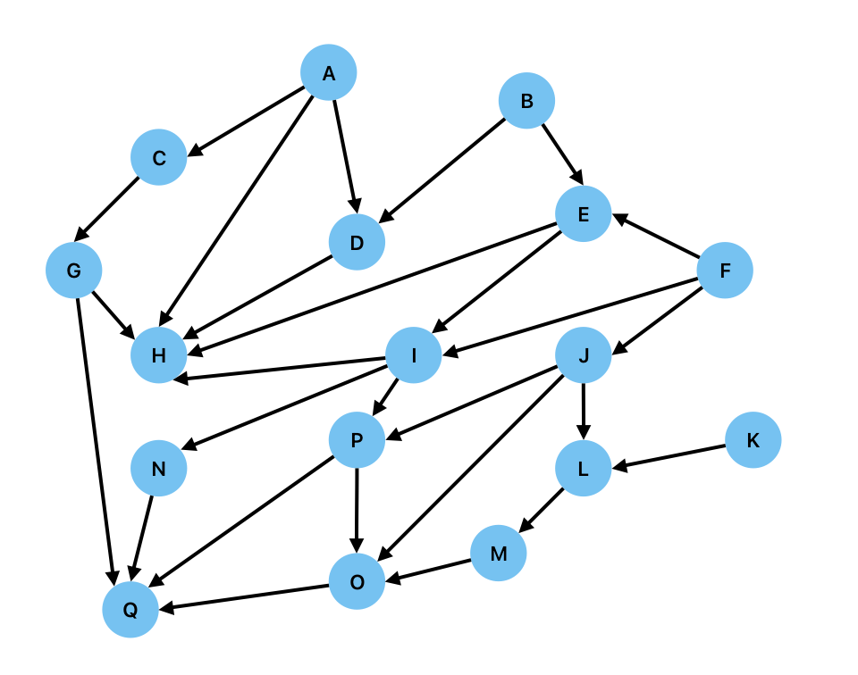

# ECS8052 Class Test 1, 12 October 2026

* Time allowed: 1 hour
* Candidates may bring with them a pencil case.
* Paper for rough working will be provided.
* No materials other than pens/pencils will be permitted.
* No mobile phones, laptops, or other electronic devices will be permitted on the desk.
* Smart watches/glasses must be removed.
* The lab computers must be used. This is so we can monitor network traffic.
* Candidates should answer all questions.

---

## Part 1 [1 marks each - 5 marks total]

Each example gives a  **knowledge base** of facts (reusing the letters P, Q, R, S). Using only the information given in the knowledge base, you are asked to evaluate whether a series of statements are True of False.

---

1. You are given the following facts:

a) $\lnot  P$  
b) $Q$  
c) $Q \implies S$  
d) $R \implies P$  
e) $\lnot  R \lor  P$  
f) $P \lor  S$  

Evaluate whether the following statements are True or False:

i) $P \lor  Q$  
ii) $R$  
iii) $Q \implies R$  
iv) $\lnot  P \land  S$  
v) $R \iff S$. 

---

2. You are given the following facts:

a) $\lnot  P$  
b) $\lnot  Q$  
c) $(\lnot  P \land  \lnot  Q) \implies R$  
d) $R \implies \lnot  S$  
e) $P \lor  \lnot  Q$  
f) $Q \implies S$  

Evaluate whether the following statements are True or False:

i) $R$  
ii) $P \lor  R$  
iii) $Q \iff S$  
iv) $R \implies P$  
v) $S$. 

---

3. You are given the following facts:

a) $P$  
b) $Q$  
c) $(P \land  Q) \implies \lnot  R$  
d) $\lnot  R \implies S$  
e) $R \lor  S$  
f) $\lnot  (P \land  R)$  

Evaluate whether the following statements are True or False:

i) $R$  
ii) $P \implies S$  
iii) $Q \land  R$  
iv) $\lnot  P \lor  R$  
v) $S \iff P$. 

---

4. You are given the following facts:

a) $P \land  Q$  
b) $Q \implies R$  
c) $R \implies S$  
d) $\lnot  P \lor  Q$  
e) $S \lor  \lnot  R$  

Evaluate whether the following statements are True or False:

i) $P$  
ii) $R$  
iii) $R \land  S$  
iv) $P \lor  \lnot  Q$  
v) $\lnot  R \lor  \lnot  S$. 

---

5. You are given the following facts:

a) $\lnot  (P \lor  Q)$  
b) $Q \lor  R$  
c) $R \implies \lnot  S$  
d) $\lnot  (P \land  R)$  
e) $\lnot  S \lor  \lnot  Q$  
f) $P \implies S$  

Evaluate whether the following statements are True or False:

i) $R$  
ii) $S$  
iii) $P \lor  Q$  
iv) $R \land  \lnot  S$  
v) $Q \implies S$. 

---

## Part 2: Knowledge Bases with Predicates and Quantifiers [2 marks each - 6 marks total]

Each example gives a **domain** of individuals and a **knowledge base** of facts using predicates (reusing the letters P, Q, R, S) together with quantifiers ($\forall$, $\exists$). Using only the information given in the knowledge base, work out the truth value of each statement.

---

6. Domain: $D = \{Ana, Ben, Cara\}$. Predicates: $Student(x)$, $Employed(x)$, $Teaches(x,y)$.

You are given the following facts:

a) $Student(Ana)$  
b) $\lnot Student(Ben) \land \lnot Student(Cara)$  
c) $\forall x\,(Student(x) \implies \lnot Employed(x))$  
d) $Employed(Ben)$  
e) $Teaches(Cara, Ana)$  
f) $\forall x\,(Teaches(Cara, x) \implies Student(x))$  

Evaluate whether the following statements are True, False, or Cannot Be Determined:

i) $Employed(Ana)$  
ii) $Employed(Cara)$  
iii) $\exists x\, Teaches(Cara, x)$  
iv) $\exists x\,(Teaches(Ben,x))$  
v) $\lnot\exists x (Teaches(Cara,x)\land\lnot Student(x))$. 

---

7. Domain: $D = \{Sparrow, Penguin, Bat\}$. Predicates: $Bird(x)$, $CanFly(x)$, $HasFeathers(x)$.

You are given the following facts:

a) $Bird(Sparrow) \land Bird(Penguin)$  
b) $\lnot Bird(Bat)$  
c) $\forall x\,(Bird(x) \implies HasFeathers(x))$  
d) $CanFly(Sparrow)$  
e) $\lnot CanFly(Penguin)$  
f) $CanFly(Bat)$  

Evaluate whether the following statements are True, False, or Cannot Be Determined:

i) $HasFeathers(Sparrow)$  
ii) $HasFeathers(Bat)$  
iii) $\exists x\,(Bird(x) \land \lnot CanFly(x))$  
iv) $\lnot\exists x\, \lnot CanFly(x)$  
v) $\forall x (Bird(x) \iff CanFly(x))$. 

---

8. Domain: $D = \{S1, S2, S3\}$. Predicates: $Square(x)$, $Red(x)$, $Bigger(x,y)$.

You are given the following facts:

a) $Square(S1) \land Square(S2)$  
b) $\lnot Square(S3)$  
c) $\forall x\,(Square(x) \implies \lnot Red(x))$  
d) $Bigger(S2, S1)$  
e) $Bigger(S1, S3)$  

Evaluate whether the following statements are True, False, or Cannot Be Determined:

i) $Red(S1)$  
ii) $Red(S3)$  
iii) $Bigger(S2, S3)$  
iv) $\exists x\,(Square(x) \land \lnot Red(x))$  
v) $\exists x\,(Square(x) \implies Red(x))$. 

---

## Part 3 [1.5 marks each - 6 marks total]

The following graph represents a rule-based system.

For each of the following cases, state whether the goal is supported by the fact and determine the path taken through the graph. You should include the start and finish nodes in your sequence. Where there is a choice of nodes, they should be traversed in alphabetical order. If a node has previously been traversed, you should not include it twice.

---

9. Fact A, Goal Q, using Forward Chaining and Breadth-First search.

---

10. Fact B, Goal Q, using Backward Chaining and Depth-first search.

---

11. Fact A, Goal O, using Forward Chaining and Depth-first search.

---

12. Goal M, Fact B using Backward Chaining and Breadth-first search

---

## Part 4 [1 mark each - 3 marks total]

What logical expression is represented by each of the following Kanren goals?

---

13. `lany(eq(P,True), eq(Q, False))`

a) $P\land \lnot Q$  
b) $P\lor \lnot Q$  
c) $P\lor Q$

---

14. `lall(eq(P,True), eq(Q, False), lany(eq(R,True),eq(S,False)))`

a) $P\lor \lnot Q\lor (R\land\lnot S)$  
b) $P\land Q\land (R\lor\lnot S)$  
c) $P\land \lnot Q\land (R\lor\lnot S)$  

---

15. `conde(
        (lall((eq(P,True),eq(Q,True)))),
        (lall((eq(P,False),eq(Q,False))))
        )`

a) $P\iff Q$  
b) $(P\lor Q)\land(\lnot P\lor \lnot Q)$  
c) $(P\land Q)\land(\lnot P\land \lnot Q)$  

