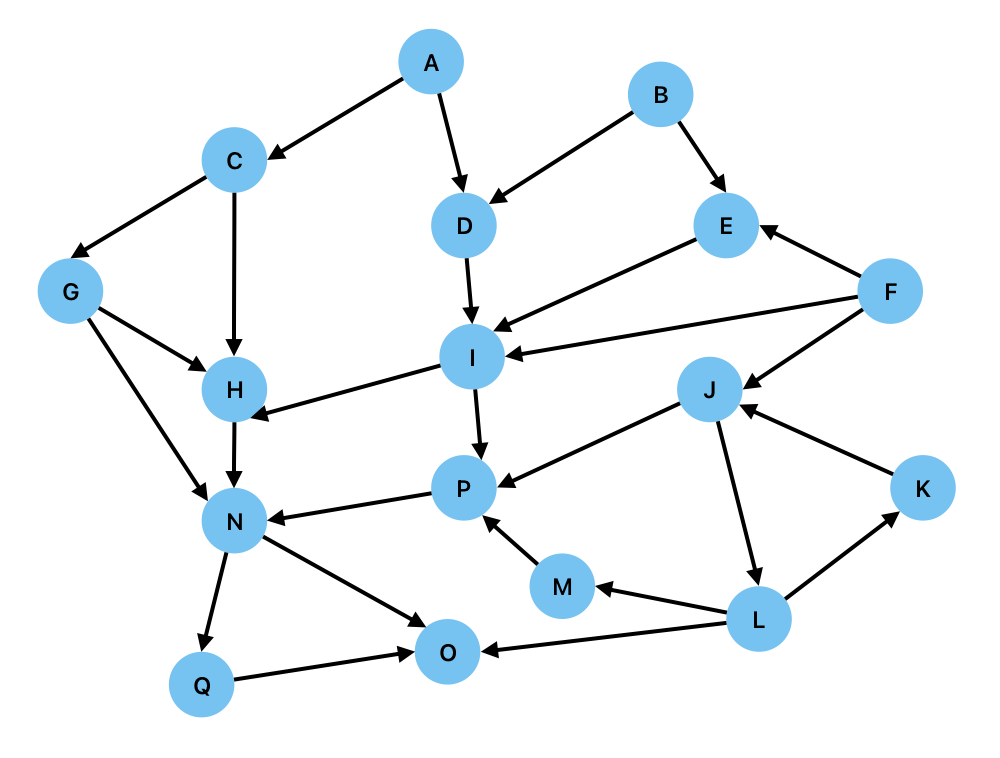

# ECS8052 Class Test 1, 12 October 2026

* Time allowed: 1 hour

## Part 1 [1 marks each - 5 marks total]

Each example gives a  **knowledge base** of facts (reusing the letters P, Q, R, S). Using only the information given in the knowledge base, you are asked to evaluate whether a series of statements are True of False.

---

1. You are given the following facts:

a) $P$  
b) $P \implies Q$  
c) $Q \implies R$  
d) $R \implies \lnot  S$  
e) $\lnot  P \lor  Q$  
f) $Q \iff R$  

Evaluate whether the following statements are True or False:

i) $Q$  
ii) $S$  
iii) $R \implies S$  
iv) $P \land \lnot  Q$  
v) $\lnot  S \lor  R$. 

---

2. You are given the following facts:

a) $P$  
b) $\lnot  Q$  
c) $(P \lor  Q) \implies R$  
d) $R \implies S$  
e) $\lnot  (Q \land  S)$  
f) $P \implies \lnot  Q$  

Evaluate whether the following statements are True or False:

i) $R$  
ii) $S$  
iii) $Q \lor  S$  
iv) $P \land  Q$  
v) $\lnot  R \lor  \lnot  S$. 

---

3. You are given the following facts:

a) $Q$  
b) $Q \implies R$  
c) $R \implies S$  
d) $\lnot  R \lor  Q$  
e) $P \iff \lnot  Q$  

Evaluate whether the following statements are True or False:

i) $P$  
ii) $Q \land  R$  
iii) $S \implies P$  
iv) $\lnot  P \land  \lnot  Q$  
v) $R \lor  P$. 

---

4. You are given the following facts:

a) $P \iff Q$  
b) $Q \iff R$  
c) $\lnot  R$  
d) $R \lor  S$  
e) $\lnot  (P \land  R)$  
f) $S \implies \lnot  R$  

Evaluate whether the following statements are True or False:

i) $P$  
ii) $S$  
iii) $Q \lor  R$  
iv) $P \iff S$  
v) $\lnot  Q \land  \lnot  R$. 

---

5. You are given the following facts:

a) $P \implies Q$  
b) $\lnot  Q$  
c) $P \lor  R$  
d) $R \iff S$  
e) $\lnot  (Q \land  S)$  
f) $\lnot  P \lor  R$  

Evaluate whether the following statements are True or False:

i) $R \land  S$  
ii) $P$  
iii) $Q \lor  R$  
iv) $P \iff Q$  
v) $\lnot  R \lor  \lnot  S$. 

---

## Part 2: Knowledge Bases with Predicates and Quantifiers [2 marks each - 6 marks total]

---

Each example gives a **domain** of individuals and a **knowledge base** of facts using predicates (reusing the letters P, Q, R, S) together with quantifiers ($\forall$, $\exists$). Using only the information given in the knowledge base, work out the truth value of each statement.

---

6. Domain: $D = \{2, 3, 4, 6\}$. Predicates: $Even(x)$, $Prime(x)$, $Divides(x,y)$.

You are given the following facts:

a) $Even(2) \land Even(4) \land Even(6)$  
b) $\lnot Even(3)$  
c) $Prime(2) \land Prime(3)$  
d) $\lnot Prime(4) \land \lnot Prime(6)$  
e) $\forall x\,(Prime(x) \implies Divides(x, 6))$  
f) $\lnot Divides(4, 3)$  

Evaluate whether the following statements are True, False, or Cannot Be Determined:

i) $Prime(2) \land Even(2)$  
ii) $Divides(3, 6)$  
iii) $Divides(4, 6)$  
iv) $\forall x\, Prime(x)$  
v) $\exists x\,(Even(x) \land \lnot Prime(x))$. 

---

7. Domain: $D = \{Alice, Bob, Chen\}$. Predicates: $Enrolled(x)$, $Studied(x)$, $Passed(x)$, $Helped(x,y)$.

You are given the following facts:

a) $Enrolled(Alice) \land Enrolled(Bob) \land Enrolled(Chen)$  
b) $\forall x\,(Enrolled(x) \land Studied(x) \implies Passed(x))$  
c) $Studied(Alice)$  
d) $\lnot Studied(Bob) \land \lnot Studied(Chen)$  
e) $\lnot Passed(Bob)$  
f) $Helped(Alice, Chen)$  

Evaluate whether the following statements are True, False, or Cannot Be Determined:

i) $Passed(Alice)$  
ii) $Passed(Chen)$  
iii) $\exists x\, Helped(Alice, x)$  
iv) $\forall x\, Enrolled(x)$  
v) $Studied(Bob) \lor Passed(Bob)$.  

---

8. Domain: $D = \{Norway, Sweden, Finland\}$. Predicates: $Coastal(x)$, $EU\_Member(x)$, $Borders(x,y)$.

You are given the following facts:

a) $Coastal(Norway) \land Coastal(Sweden) \land Coastal(Finland)$  
b) $EU\_Member(Sweden) \land EU\_Member(Finland) \land \lnot EU\_Member(Norway)$  
c) $\forall x\,(EU\_Member(x) \implies Coastal(x))$  
d) $Borders(Norway, Sweden)$  
e) $Borders(Sweden, Finland)$  
f) $Borders(Norway, Finland)$  

Evaluate whether the following statements are True, False, or Cannot Be Determined:

i) $EU\_Member(Norway)$  
ii) $\exists x\, Borders(Norway, x)$  
iii) $Borders(Finland, Norway)$  
iv) $\forall x\, Coastal(x)$  
v) $EU\_Member(Sweden) \land Borders(Sweden, Finland)$. 

---

## Part 3 [1.5 marks each - 6 marks total]

---

The following graph represents a rule-based system.

For each of the following cases, state whether the goal is supported by the fact and determine the path taken through the graph. You should include the start and finish nodes in your sequence. Where there is a choice of nodes, they should be traversed in alphabetical order. If a node has previously been traversed, you should not include it twice.

---

9. Fact A, Goal Q, using Forward Chaining and Breadth-First search.

---

10. Fact B, Goal Q, using Backward Chaining and Depth-first search.

---

11. Fact A, Goal L, using Forward Chaining and Depth-first search.

---

12. Goal P, Fact B using Backward Chaining and Breadth-first search

---

## Part 4 [1 mark each - 3 marks total]

---

What logical expression is represented by each of the following Kanren goals?

---

13. `lall(eq(P,False), eq(Q, False))`

a) $P\land Q$  
b) $\lnot P\lor \lnot Q$  
c) $\lnot P\land \lnot Q$  

---

14. `lany(eq(P,False), eq(Q, True), lall(eq(R,False),eq(S,False)))`

a) $\lnot P\lor Q\lor (\lnot R\land\lnot S)$  
b) $\lnot P\land Q\land (\lnot R\lor\lnot S)$  
c) $P\land \lnot Q\land (R\lor\lnot S)$  

---

15. `conde(
        (lall((eq(P,False),eq(Q,True)))),
        (lall((eq(P,True),eq(Q,False))))
        )`

a) $(\lnot P\lor Q)\land(P\lor \lnot Q)$  
b) $\lnot(P\iff Q)$  
c) $(\lnot  P\land Q)\land(P\land \lnot Q)$  
